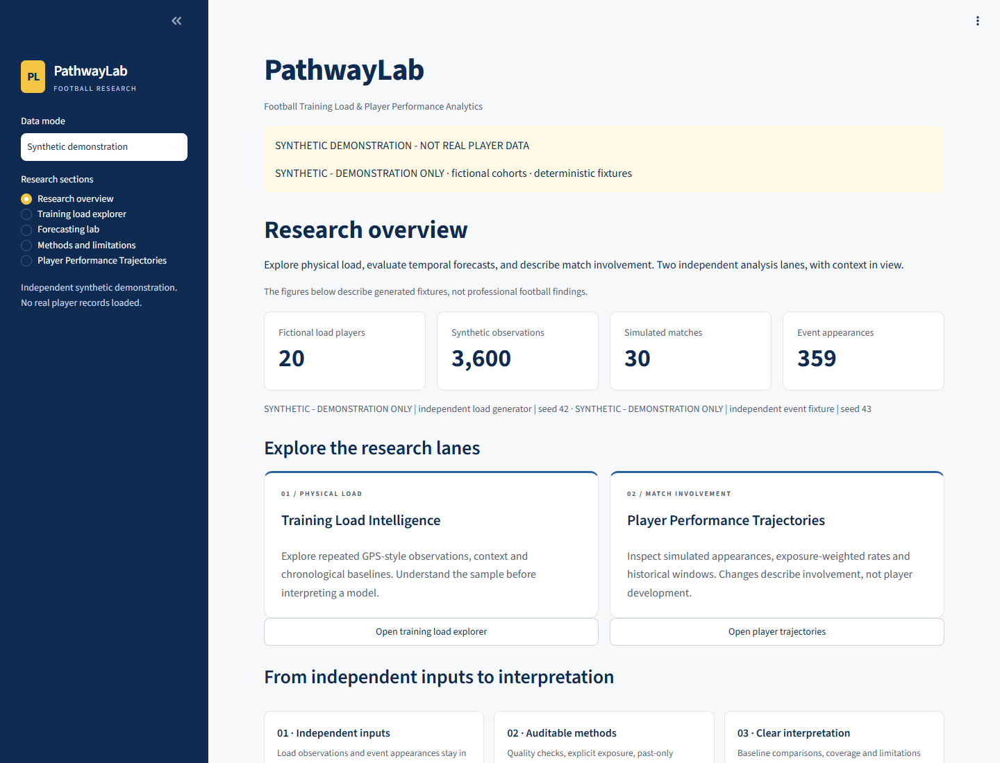
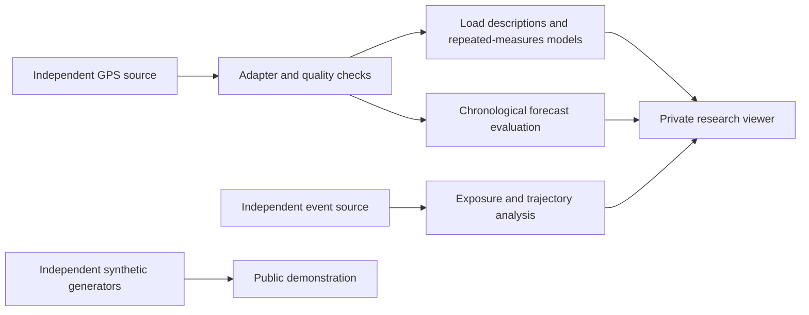

# PathwayLab

**Football Training Load & Player Performance Analytics**

Independent football research software for longitudinal load analysis, temporal
forecasting and exposure-aware match involvement—with reproducibility and clear
evidence boundaries throughout.



**SYNTHETIC DEMONSTRATION - NOT REAL PLAYER DATA**  
**SYNTHETIC - DEMONSTRATION ONLY**

The public application uses independently generated fictional observations. Every
displayed sample size, rate and demonstration forecast score is calculated from
those fixtures. Original GPS/event records and real individual predictions are not
bundled. Live-demo and repository links will be added only after verified publication.

## Why this project

Football indicators depend on schedule, role, playing exposure and observation
coverage. PathwayLab asks three focused questions:

- How much observed physical-load variation is within versus between players?
- Can strictly historical features forecast later observed load beyond simple baselines?
- How do match-involvement rates change across appearances and available seasons?

The software brings data engineering, exploratory longitudinal statistics,
machine learning evaluation and research visualization into an auditable workflow.
It does not predict injury, readiness, player potential or causal training effects.

## Explore the application

| Section | What it shows |
|---|---|
| Research overview | Two independent analysis lanes, computed demo coverage and the workflow |
| Training load explorer | Fictional-player/date/position filters, explicit units and longitudinal distributions |
| Forecasting lab | Calculated synthetic holdout MAE/RMSE, historical baselines and prediction diagnostics |
| Player Performance Trajectories | Simulated exposure, season rates, shifted windows and peer distributions |
| Methods and limitations | Research design, provenance, temporal leakage controls and interpretation limits |

The interface uses an independent navy/yellow visual identity, system fonts,
responsive layouts and source captions. It uses no club logos or third-party imagery.

## Architecture



**GPS and event people are unrelated.** No player-level join exists between these
sources. The two public-demo cohorts also use separate fictional identities.

## Run the data-free demo

Python 3.10 or newer. From the project root:

```bash
python -m venv .venv
# PowerShell: .\.venv\Scripts\Activate.ps1
# macOS/Linux: source .venv/bin/activate
python -m pip install -e '.[dev,app,research]'
pytest -q -m "not integration"
python -m pathwaylab.cli --mode demo
python -m streamlit run app/public_demo.py
```

The public entry point forces synthetic-only mode, even if a local research flag
is accidentally present. It requires no datasets, login, API key or network data
download. The CLI demonstration is also reproducible and explicitly synthetic.
See [REPRODUCIBILITY.md](REPRODUCIBILITY.md) for tested commands and environments.

## Research modules and principles

**Physical load.** Checksummed ingestion, explicit coverage and denominators,
descriptive profiles, random-intercept diagnostics and target-date forecasting.
Real research predicts next-observed-session HSR with shifted history and
training-only preprocessing. Full-season-normalized RATIO* fields are excluded.
Validation supports model selection before final-period evaluation.

**Match involvement.** A separate source-ID lane validates events/lineups,
reconstructs estimated exposure and computes summed-count per-90 rates. Historical
windows use prior appearances only. Inclusion, missing coverage, roles, tactics
and estimated minutes constrain longitudinal interpretations.

**Public calculation.** The toy forecast reuses the existing demo's cumulative
next-training-block target and compares Ridge, persistence and training median
on identical targets. Its scores are not comparable to the real session benchmark.
The event generator independently simulates counts and minutes. It is not an
event/tracking integration or a professional-player model.

Detailed definitions are in [docs/METHODS.md](docs/METHODS.md). Original numerical
findings, private audits and real screenshots are withheld from this public package.

## Engineering and verification

- Deterministic fixtures and independently recomputed demo metrics.
- Tests for leakage, chronology, denominators, missing artifacts and forged-mode access.
- Full Ruff lint and formatting checks, import/dependency checks and wheel packaging.
- Offline CI designed to run without downloaded research records.
- Genuine Chrome inspection at 1440, 1280, 768 and 390 pixels.

Release preparation passed 54 public fixture tests, 64 original-workspace tests,
full Ruff checks and wheel packaging on Windows/Python 3.12. Genuine Chrome
checks covered all five sections at four widths. The ten extra local tests require
authorized research artifacts and are not bundled with the public fixtures.
Exact evidence and publication status are recorded in FINAL_RELEASE_REPORT.md.
A workflow file is not evidence that hosted CI has run. No clinical,
prospective deployment or accessibility certification is implied.

## Data, licensing and limitations

Research source references: [Zenodo GPS record](https://zenodo.org/records/18986229),
[Sierra-Casas et al. dataset descriptor](https://doi.org/10.3390/data11040084) and
[StatsBomb Open Data](https://github.com/hudl/open-data). These populations are
unlinked. Their original terms apply separately from any original-code license.
See [DATA_ACCESS_AND_LICENSE.md](DATA_ACCESS_AND_LICENSE.md) and
[ACKNOWLEDGEMENTS.md](ACKNOWLEDGEMENTS.md).

The code-license choice is awaiting owner confirmation. External datasets are not
relicensed or redistributed here. The public app is deliberately data-free.

The real GPS sample is small and dependent, with incomplete exposure/coding
metadata. Forecasting is conditional retrospective prediction assuming a known
target date, not demonstrated prospective operational effectiveness. Event findings
are sensitive to coverage and timestamp inclusion. Counts and load do not establish
fitness, talent or player development. These limitations remain part of the project.

## Future linked-data research

A proposed MSc extension asks whether verified prior playing exposure and frozen
pre-session plans add predictive value beyond GPS history. That question requires
approved matched data, known-at timestamps, governance and a feasible sample. No
such connected-data experiment, club access or supervision is claimed.

## Author

**Muhammad Rauf** — Erasmus Mundus MSc in Communications Engineering and Data
Science (CoDaS), currently at UPC BarcelonaTech after study at Aalto University.

[Portfolio](https://mrtrauf.github.io/) · [GitHub profile](https://github.com/MRTRauf)

Independent research portfolio. No official affiliation, collaboration or endorsement
by Brøndby IF. The project supports exploration of Spring 2027 MSc thesis opportunities.
